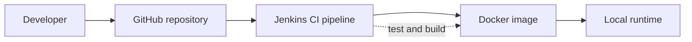

# Learning Architecture

## M0 — Local CI/CD flow

Jenkins will eventually check out application code from GitHub, run tests, and build a Docker image. The local runtime will run that image; registry publishing, environment promotion, and Huawei Cloud deployment are later milestones.

This is a conceptual learning diagram only. It does not represent an active Jenkins server, deployed workload, or authorized cloud architecture.
